# ResepKu

Aplikasi mobile Flutter untuk menjelajahi resep masakan dan menyimpan koleksi pribadi lengkap dengan catatan dan rating. Katalog resep diambil dari REST API publik TheMealDB, sedangkan data personal (resep tersimpan, catatan, rating) disimpan di database Supabase.

Project UTS mata kuliah Pemrograman Mobile.

<!-- PERIKSA: tambahkan satu kalimat tentang tujuan aplikasi dengan bahasamu sendiri bila perlu. -->

## Identitas

| | |
|---|---|
| Nama | Kadek Nova Krisna Putra |
| NIM | 2415051117 |
| Kelas | PTI 5C |

## Fitur

**Katalog dan pencarian**
- Beranda dengan resep unggulan, kategori, dan rekomendasi.
- Pencarian resep berdasarkan nama dengan debounce, sehingga API tidak dipanggil di setiap ketikan.
- Filter berdasarkan kategori; filter dibagikan antara Beranda dan Cari (shared state).
- Detail resep: foto, kategori dan asal, bahan yang bisa dicentang, dan langkah memasak. Detail lengkap dimuat dari API bila belum tersedia.

**Koleksi pribadi (CRUD ke database)**
- Simpan resep ke koleksi dengan catatan dan rating (form dengan validasi).
- Lihat koleksi beserta ringkasannya.
- Ubah catatan dan rating.
- Hapus resep dari koleksi dengan dialog konfirmasi; bisa juga lewat geser kartu.
- Tarik layar untuk memuat ulang koleksi.

**Profil dan identitas aplikasi**
- Pengisian profil (nama, NIM, kelas) saat pertama kali dibuka, disimpan di perangkat.
- Ubah profil dan keluar dari profil.
- Logo, ikon aplikasi, dan splash screen.

**Kualitas aplikasi**
- Layout responsif: navigasi bawah berbentuk pil melayang di layar sempit, rail di layar lebar, dan grid 2, 3, atau 4 kolom menurut lebar layar.
- State loading, error, dan empty di semua layar yang memuat data.
- Penanganan error terpisah untuk validasi form, jaringan dan API (timeout, koneksi, kode status), serta database.
- SnackBar dan dialog untuk memberi umpan balik pada operasi penting.
- Koleksi tiap pengguna terpisah (lihat bagian Backend).

## Tech Stack

| Bagian | Teknologi |
|---|---|
| Framework | Flutter (Dart), Material 3 |
| State management | Provider (`ChangeNotifier`) |
| HTTP | package `http` |
| Backend/database | Supabase (`supabase_flutter`) |
| Konfigurasi | `flutter_dotenv` |
| Penyimpanan lokal | `shared_preferences` (profil) |
| Font | Poppins (SIL Open Font License, lihat `assets/fonts/OFL.txt`) |

## REST API

**TheMealDB** (https://www.themealdb.com/api.php), API publik gratis tanpa kunci rahasia.

Base URL: `https://www.themealdb.com/api/json/v1/1/`

| Kebutuhan | Endpoint |
|---|---|
| Daftar kategori | `categories.php` |
| Resep per kategori | `filter.php?c={kategori}` |
| Pencarian berdasarkan nama | `search.php?s={kata kunci}` |
| Detail resep | `lookup.php?i={id}` |

<!-- PERIKSA: cocokkan tabel ini dengan lib/services/meal_api_service.dart, terutama endpoint yang dipakai untuk rekomendasi Beranda, lalu tambahkan atau hapus barisnya. -->

Data diubah menjadi model Dart (`Meal`, `MealCategory`) lewat `fromJson`. Kesalahan jaringan, timeout, dan kode status selain 200 ditangkap dan diubah menjadi pesan yang ramah bagi pengguna.

## Backend dan Database

**Supabase** (PostgreSQL) dengan masuk anonim (anonymous sign-in): setiap pemasangan aplikasi mendapat identitas pengguna sendiri tanpa kata sandi. Aplikasi hanya memakai kunci **publishable (anon)**. Kunci rahasia (`service_role`) tidak dipakai dan tidak ada di repositori.

Pembagian peran: API menyediakan katalog, database menyimpan data personal.

**Tabel `saved_recipes`**

| Kolom | Tipe | Keterangan |
|---|---|---|
| `id` | uuid | Primary key |
| `user_id` | uuid | Pemilik baris, diisi `auth.uid()` oleh database |
| `meal_id` | text | ID resep dari TheMealDB |
| `meal_name` | text | Nama resep |
| `meal_thumb` | text | URL foto (opsional) |
| `note` | text | Catatan pengguna |
| `rating` | int | 1 sampai 5 (opsional) |
| `created_at` | timestamptz | Waktu disimpan |

Satu pengguna tidak dapat menyimpan resep yang sama dua kali (`unique (user_id, meal_id)`).

**Keamanan.** Row Level Security aktif dengan empat policy (select, insert, update, delete) yang membatasi akses ke baris milik pengguna sendiri (`auth.uid() = user_id`). Skema lengkap ada di [`supabase/schema.sql`](supabase/schema.sql).

## Arsitektur

```
UI (screens, widgets)
        |
    Provider  (ChangeNotifier: state loading / data / error)
        |
   Repository (kontrak abstrak + implementasi)
        |
     Service  (HTTP ke TheMealDB, query ke Supabase)
        |
REST API / Database
```

Aturan utama: screen tidak memanggil HTTP atau database secara langsung. Repository didefinisikan sebagai kelas abstrak sehingga implementasinya (nyata atau palsu untuk pengujian) dapat diganti tanpa mengubah provider dan UI.

```
lib/
  core/          tema, breakpoint, validator, konfigurasi Supabase, exception, enum status
  models/        Meal, MealCategory, SavedRecipe, UserProfile
  services/      MealApiService, SavedRecipeService, ProfileService
  repositories/  kontrak abstrak, implementasi, dan versi palsu untuk tes
  providers/     RecipeProvider, RecipeDetailProvider, SavedRecipeProvider, ProfileProvider
  screens/       Beranda, Cari/Daftar, Detail, Catatan (Create/Edit), Koleksi, Profil, dan lainnya
  widgets/       RecipeCard, StateView, MealImage, CategoryChip, FloatingNavBar, dan lainnya
  main.dart
```

| Provider | Tanggung jawab |
|---|---|
| `RecipeProvider` | Kategori, rekomendasi, katalog, dan filter bersama (kategori dan kata kunci) |
| `RecipeDetailProvider` | Detail lengkap satu resep |
| `SavedRecipeProvider` | Koleksi tersimpan dan operasi CRUD |
| `ProfileProvider` | Profil pengguna di perangkat |

## Screenshot

| Home | List (Cari) | Detail |
|---|---|---|
| 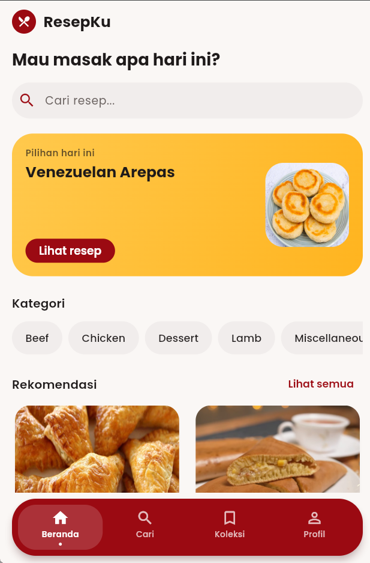 | 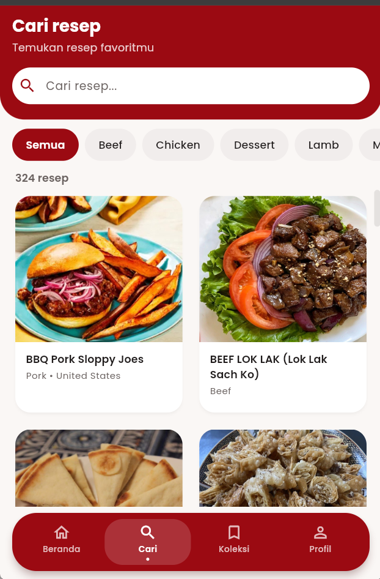 | 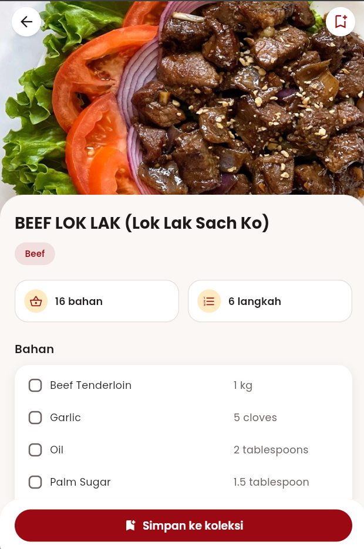 |

| Create | Edit | Koleksi |
|---|---|---|
| 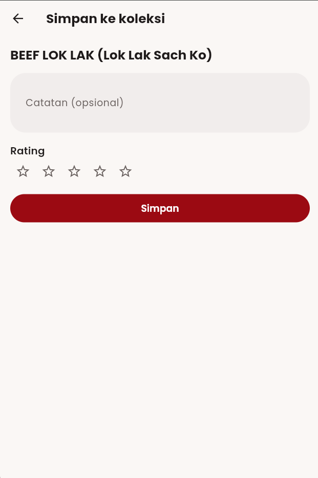 | 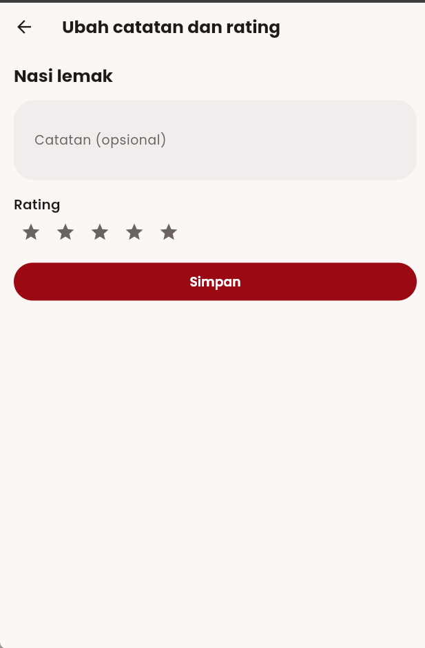 | 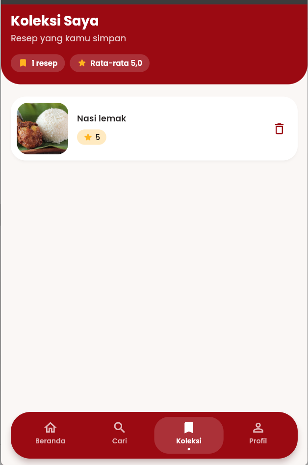 |

**Layout responsif**

| Layar sempit | Layar lebar |
|---|---|
| 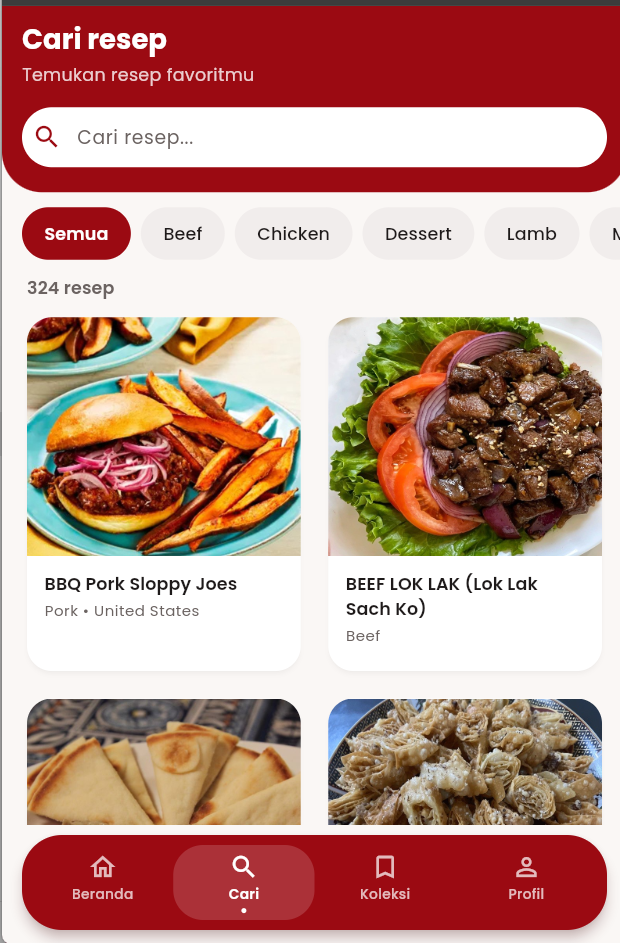 | 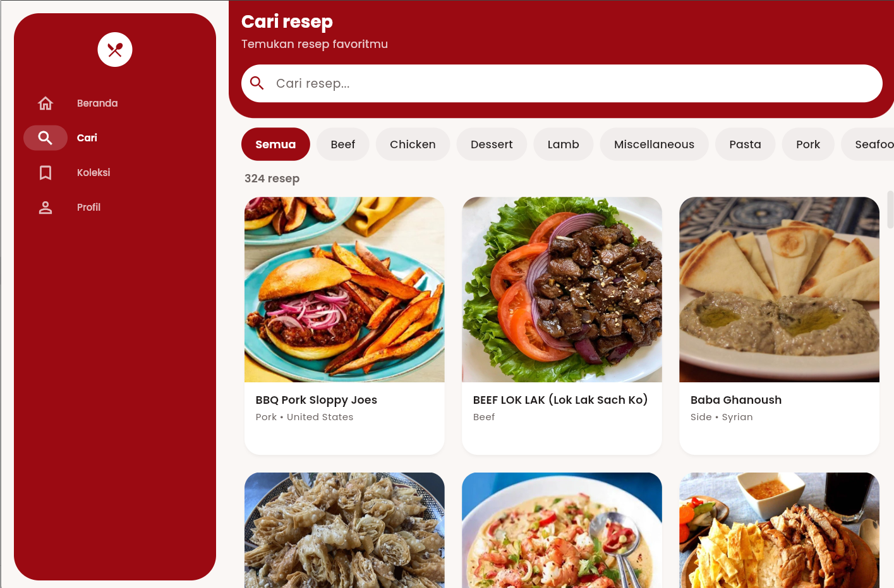 |

**Data dari API dan database**

| Respons REST API | Tabel di database |
|---|---|
| 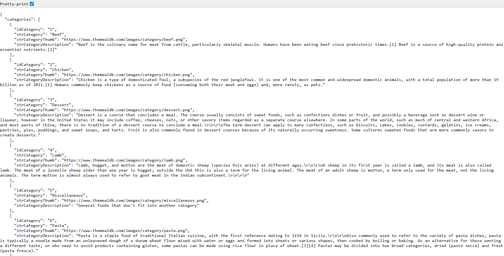 |  |

## Cara Menjalankan

### Prasyarat
- Flutter SDK (stable) dan Android SDK, atau Google Chrome untuk menjalankan versi web.
- Akun Supabase (gratis).

### 1. Ambil kode

```bash
git clone https://github.com/kadeknova761-beep/UTS_2415051117_KadekNovaKrisnaPutra.git
cd UTS_2415051117_KadekNovaKrisnaPutra
flutter pub get
```

### 2. Siapkan Supabase
1. Buat proyek baru di Supabase.
2. Buka **Authentication, Sign In / Providers**, lalu aktifkan **Allow anonymous sign-ins**.
3. Buka **SQL Editor**, jalankan isi berkas `supabase/schema.sql`.
4. Salin **Project URL** dan **publishable (anon) key** dari pengaturan API proyekmu.

### 3. Buat berkas `.env`

Salin `.env.example` menjadi `.env` di folder utama proyek, lalu isi nilainya:

```
SUPABASE_URL=https://<project-ref>.supabase.co
SUPABASE_ANON_KEY=<publishable-atau-anon-key>
```

`.env` sengaja tidak ikut di Git. Berkas ini harus ada sebelum `flutter run` atau `flutter build`, karena didaftarkan sebagai aset. Jangan pernah mengisinya dengan kunci `service_role`.

### 4. Jalankan

```bash
flutter run                  # perangkat Android atau emulator
flutter run -d chrome        # versi web
```

### Pengujian dan build

```bash
flutter analyze
flutter test
flutter build apk --release
```

### Kendala build di Windows (cache di drive berbeda)

Bila proyek berada di drive selain tempat cache paket Flutter (misalnya proyek di `D:` dan cache pub di `C:`), build Android dapat gagal dengan galat `Could not close incremental caches ... different roots`. Solusinya, arahkan cache pub ke drive yang sama dengan proyek:

```powershell
New-Item -ItemType Directory -Force D:\pub-cache
[Environment]::SetEnvironmentVariable("PUB_CACHE", "D:\pub-cache", "User")
```

Tutup dan buka kembali terminal, lalu jalankan `flutter clean` dan `flutter pub get`.

## Catatan

- Profil (nama, NIM, kelas) disimpan hanya di perangkat dan bukan sistem login. Koleksi terikat ke identitas anonim di perangkat tersebut; menghapus data aplikasi atau memasang ulang akan membuat koleksi baru.
- Lisensi font: Poppins, SIL Open Font License 1.1 (`assets/fonts/OFL.txt`).
## Screenshot Tambahan

| Sambutan | Profil | Hasil pencarian |
|---|---|---|
| 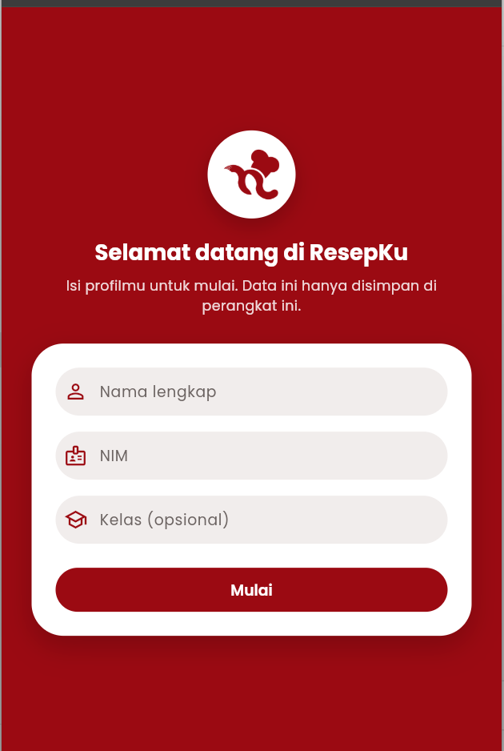 | 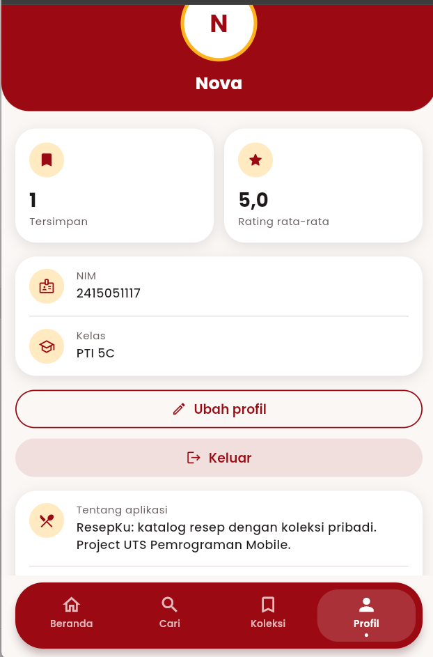 | 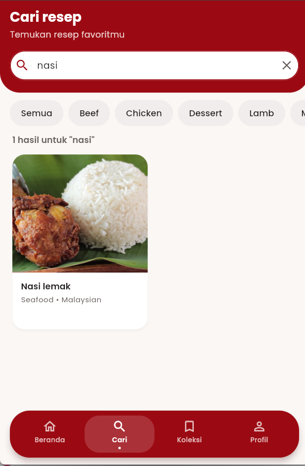 |
